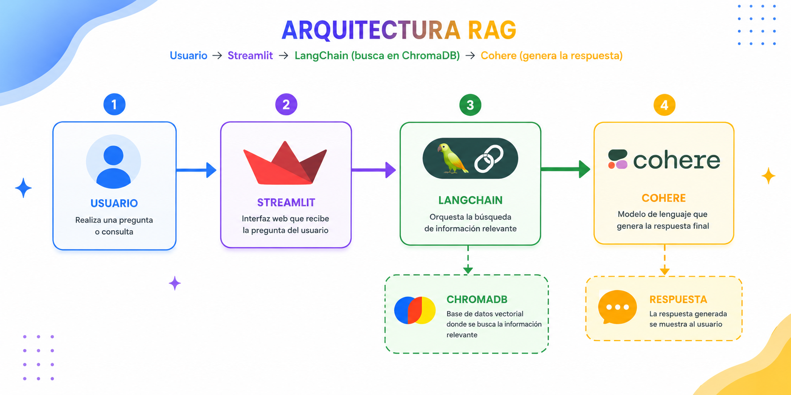
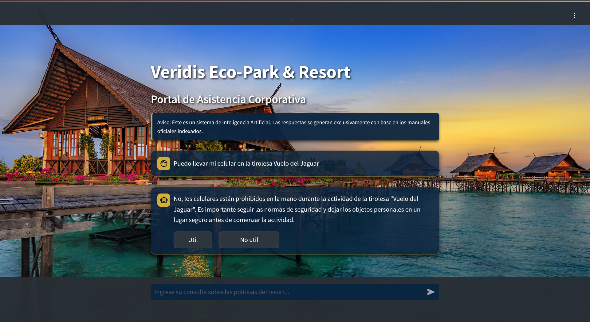
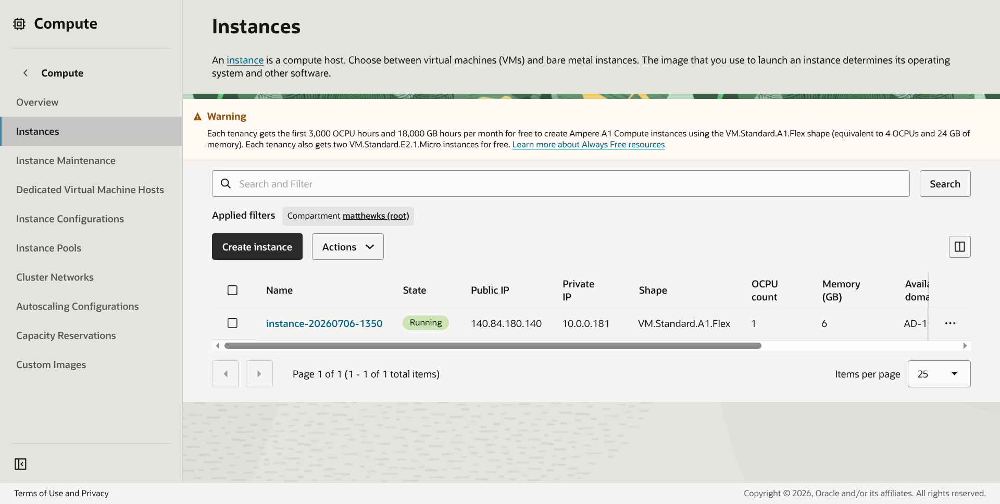

# Veridis Hotel Agent: Implementación RAG para Hostelería

Bienvenido al repositorio del asistente virtual para el Veridis Eco-Park & Resort. Este proyecto fue desarrollado como entrega final para el Challenge de Alura enfocado en Agentes Inteligentes.

## El Contexto del Proyecto

Construir un chatbot básico hoy en día es relativamente sencillo, pero construir uno que no alucine ni invente información cuando se le pregunta sobre reglas de negocio específicas es un reto distinto. 

El objetivo principal de este proyecto fue diseñar un agente capaz de leer, comprender y responder consultas basándose estrictamente en la documentación interna de un resort (horarios, restricciones físicas en atracciones, normas de seguridad y detalles de los planes de alojamiento). Para lograr esto sin que el modelo de lenguaje inventara respuestas, implementé una arquitectura RAG (Retrieval-Augmented Generation).

## Arquitectura de la Solución

El núcleo de este agente no es solo un modelo de lenguaje, sino un sistema de recuperación de información que actúa como filtro previo. El flujo de trabajo funciona de la siguiente manera:

1. Ingesta y Procesamiento: Los documentos base (PDFs y archivos Markdown con las reglas del hotel) son procesados y divididos en fragmentos más pequeños (chunks) utilizando LangChain para preservar el contexto semántico.
2. Vectorización: Cada fragmento es convertido en vectores matemáticos (embeddings) mediante los modelos open-source de HuggingFace.
3. Almacenamiento: Los vectores se almacenan en una base de datos local construida con ChromaDB.
4. Recuperación: Cuando un usuario hace una pregunta a través de la interfaz de Streamlit, el sistema busca en ChromaDB los fragmentos de texto más similares a la consulta.
5. Generación: Estos fragmentos se inyectan en un prompt estricto y se envían al modelo de lenguaje de Cohere, el cual redacta una respuesta natural basada únicamente en ese contexto recuperado.

## Stack Tecnológico

La selección de tecnologías se centró en mantener el proyecto ligero, eficiente y con un alto grado de control sobre el procesamiento de datos:

* Python 3.8 como lenguaje base.
* Streamlit para el desarrollo de la interfaz interactiva web.
* LangChain como orquestador del pipeline RAG.
* ChromaDB para la base de datos vectorial.
* Sentence-transformers (HuggingFace) para los embeddings.
* Cohere (API) para el modelo de lenguaje generativo.

## El Reto del Despliegue en la Nube (OCI)

Uno de los mayores desafíos técnicos de este proyecto no fue el código en sí, sino el despliegue en un entorno de producción limitado. La aplicación está alojada en una instancia de capa gratuita de Oracle Cloud Infrastructure (OCI) con arquitectura ARM.

Durante el despliegue, el servidor presentaba errores críticos de asignación de memoria (`cannot allocate memory in static TLS block`) al intentar inicializar los procesos de Scikit-Learn y ChromaDB de forma simultánea. 

Para resolver esto, fue necesario modificar la configuración del sistema operativo:
* Se implementó un archivo de paginación (Swap) de 2GB para extender la capacidad de memoria del servidor.
* Se configuró la inyección de librerías dinámicas (`libgomp.so.1` y `libsqlite3.so`) directamente en el entorno de ejecución de Python mediante la variable `LD_PRELOAD` para garantizar que la memoria matemática se reservara correctamente antes de iniciar los hilos de la IA.

## Instrucciones de Ejecución

Para replicar este proyecto en un entorno local, sigue estos pasos:

1. Clona el repositorio:
   `git clone <https://github.com/Brando-JML/Veridis-Hotel-Agent.git>`
   `cd Veridis-Hotel-Agent`

2. Instala las dependencias necesarias:
   `pip install -r requirements.txt`

3. Ejecuta el script de indexación para generar la base de datos vectorial:
   `python src/agente_final.py`

4. Inicia la interfaz de usuario:
   `streamlit run app.py`

Nota para despliegues en servidores ARM limitados: Es posible que necesites ejecutar la aplicación forzando la carga de librerías del sistema operativo. Puedes encontrar el comando exacto utilizado en producción dentro del historial de commits de este repositorio.

## Casos de Uso y Pruebas

El agente ha sido sometido a pruebas de estrés para validar que respeta el contexto. A continuación, se muestran ejemplos de su funcionamiento:

Ejemplo de consulta operativa:
* Usuario: "¿A qué hora es el Rally Veridis y qué premios dan?"
* Agente: "El Rally Veridis se lleva a cabo todos los días a las 16:00 hrs. Está disponible para los planes Luxury y Max Adventure. El equipo ganador recibe champaña o pases gratis para el Spa Holístico."

Ejemplo de consulta restrictiva:
* Usuario: "¿Puedo llevar mi celular en la tirolesa Vuelo del Jaguar?"
* Agente: "No, por medidas de seguridad quedan estrictamente prohibidos los celulares en la mano durante el recorrido en la tirolesa."

## Evidencia de Despliegue

La aplicación se encuentra operativa y accesible a través de internet, alojada en OCI.

* URL de acceso: `[http://veridishotel.me/]`

---
Desarrollado por Brando Josue Molina Lanche